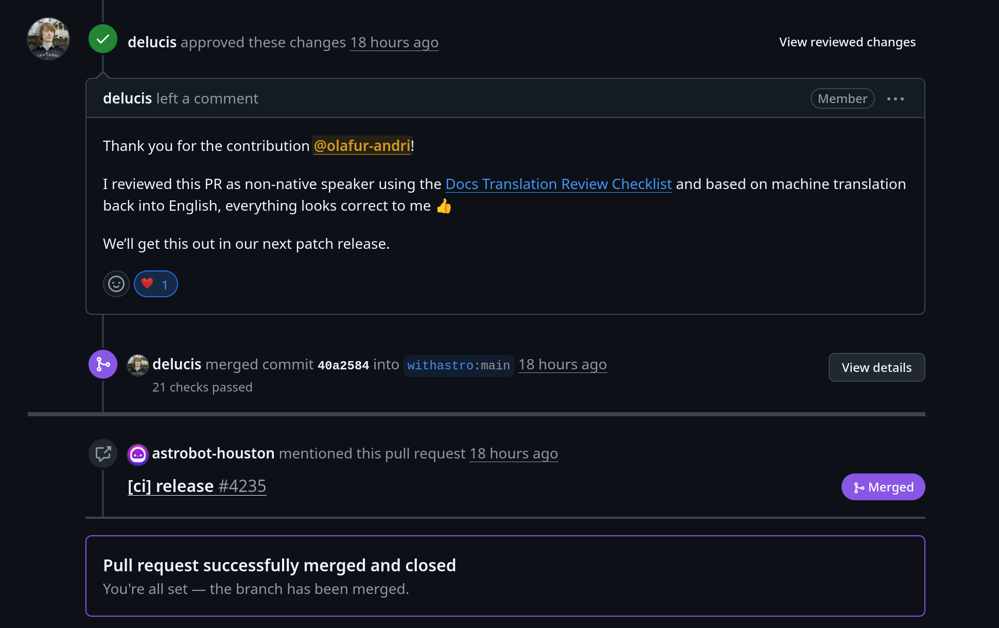

Það að smíða þessa vefsíðu hefur verið heilmikið ævintýri. Þetta var vissulega brattur
lærdómsferill, en líka tækifæri til að upplifa ýmislegt í fyrsta sinn...

<!-- excerpt -->

### DIY? Nei takk ✋🫩

Ég man varla hvenær ég bjó síðast til vefsíðu án þess að drukkna í spagettíhafi af HTML, CSS og
JavaScript. Í baráttunni við að halda mér á floti velti ég því fyrir mér hvern fjandann ég væri
eiginlega að gera hérna. „En þetta var svo einföld hugmynd!“, muldraði ég ávallt með sjálfum mér.
„Næst geri ég þetta almennilega!“ Jæja, Óli fortíðarinnar, ég held að þetta sé eitt af þessum fáu
skiptum þar sem loforðið er efnt. Þessi vefsíða er eingöngu knúin af tilbúnum lausnum og þjónustum,
og vá hvað það var góð ákvörðun! [Astro](https://astro.build/) og
[Starlight](https://starlight.astro.build/) hafa gert mér kleift að breyta nokkrum Markdown-skrám í
vefsíðu sem hefði tekið mig heilt ár að smíða 😆

### `.com`-lén eru furðu ódýr

Það kemur á óvart, er það ekki! Kannski vissirðu þetta nú þegar og finnst soldið kjánalegt að
minnast á þetta. Engu að síður er þetta lén það allra fyrsta sem ég hef nokkurn tímann keypt og ég
er mjög spenntur fyrir því. Ferlið var mun ódýrara og einfaldara en ég hafði upphaflega búist við.
Ég skoðaði nokkra lénsveitendur og þeir sem ég endaði á að velja á milli voru
[Cloudflare](https://www.cloudflare.com/domains/) og [Porkbun](https://porkbun.com/). Báðir virtust
bjóða upp á frábært virði fyrir sanngjarnt verð, svo þetta var erfið ákvörðun. Af handahófi ákvað ég
á endanum að velja Porkbun. Ég hef svo sem ekkert gáfulegt að segja um _af hverju_ ég tók þá
ákvörðun; þetta réðist bókstaflega á því að kasta krónu. Reynsla mín hefur verið góð hingað til og
ég efast ekki að Cloudflare hefði reynst mér jafn vel.

### Að dreifa góða 🇮🇸íslenska🇮🇸 orðinu

> Ókei, svo þú keyptir lén... stórmál 😒
>
> — _Þú_

Átsj. Jæja, ef það var ekki nóg til að heilla þig, þá er ég viss um að þú takir þetta til baka um
leið og þú sérð [þetta PR sem ég gerði](https://github.com/withastro/starlight/pull/4252):

**Þetta er í fyrsta sinn sem ég legg mitt af mörkum til open-source hugbúnaðar!** 🥳

Og einmitt með hætti sem stendur hjarta mínu mjög nærri: Að bæta íslenskri þýðingu við notendaviðmót
Starlight 🥹 Það kemur mér verulega á óvart að það hafi ekki verið gert áður, en ég er himinlifandi
yfir þessu tækifæri til að leggja mitt af mörkum! Það að auka aðgengi allra Íslendinga að Starlight
vefsíðum er líka risastór plús 💪

Vonandi er þetta ekki í síðasta skipti sem ég geri eitthvað slíkt!
